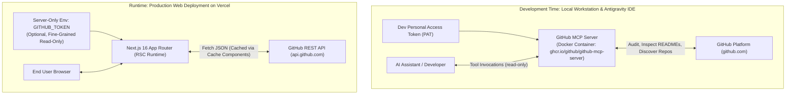

# Dynamic GitHub Integration Plan & Technical Specification

**Document Identifier:** `INT-GITHUB-2026-PHASE1C`  
**Revision:** 3.0 (Remediated for Next.js 16 Active LTS & Non-Destructive Resilience)  
**Status:** PROPOSED (Awaiting User Phase 1 Approval Gate)  
**Author:** Principal Software Architect, Senior Next.js Engineer & Security Engineer  
**Target Systems:** GitHub REST API v3, Next.js 16 App Router (Active LTS), Vercel Edge Network  
**Target User:** `SaucesCode`

---

## 1. Architectural Demarcation: GitHub MCP vs. GitHub REST API

A strict architectural distinction exists between the two mechanisms interacting with GitHub in this ecosystem:



| Dimension | GitHub MCP (`github-mcp-server`) | GitHub REST API (`api.github.com`) |
| :--- | :--- | :--- |
| **Role & Purpose** | Development-time assistive agent tool. Used in the IDE to audit code, explore README files, verify project files, and review repository structures. | Production runtime data provider. Powers dynamic telemetry, star counters, and repository listings on the public portfolio website. |
| **Deployment Location** | Local developer container / IDE process. | Executed by Next.js Server Components on Vercel Serverless / Edge runtime. |
| **Exposure to End Users** | **Zero**. Never compiled into production builds, never exposed over HTTP, and never bundled in application code. | Clean, filtered JSON payloads rendered into static HTML or passed as props to Client Components. |
| **Protocol** | Model Context Protocol (JSON-RPC over stdio). | Standard HTTPS REST API (`application/vnd.github+json`). |

---

## 2. GitHub REST API Specification & Valid Parameters

### Endpoint & Query Parameter Conformance
According to the official GitHub REST API documentation for `GET /users/{username}/repos`:

- **Target URL:** `https://api.github.com/users/SaucesCode/repos`
- **Supported Parameters:**
  - `type`: `all`, `owner`, `member` (Default: `owner`).  
    *Decision:* Set to `type=owner` to retrieve repositories owned by `SaucesCode`.
  - `sort`: `created`, `updated`, `pushed`, `full_name` (Default: `full_name`).  
    *Decision:* Set to `sort=pushed` so recently active repositories appear first.
  - `direction`: `asc`, `desc` (Default: `desc` when sorting by `pushed`).
  - `per_page`: integer, maximum 100 (Default: 30).  
    *Decision:* Set to `per_page=100`.
  - `page`: integer, defaults to 1.
- **Mandatory HTTP Headers:**
  - `Accept: application/vnd.github+json`: Explicit REST API versioning.
  - `X-GitHub-Api-Version: 2022-11-28`: Pins official API behaviors.
  - `User-Agent: SaucesCode-Portfolio-App`: Mandated by GitHub API terms of service.
  - `Authorization: Bearer <GITHUB_TOKEN>`: Optional server-only secret for elevated rate limits.

---

## 3. GitHub Authentication & Token Security

### Least-Privilege Scoping:
1. **Unauthenticated Public-Data Access Preferred Initially:**  
   The portfolio requires access only to public repository metadata (names, stars, topics, push dates). With Next.js 16 Cache Components caching data for 1 hour (`cacheLife('hours')`), total API requests are minimal and comfortably stay within the 60 requests/hour unauthenticated rate limit.
2. **Rejection of Classic `public_repo` Scope:**  
   Classic GitHub PATs with the `public_repo` scope grant **full read AND write** access to all public repositories (including code pushes, collaborator management, and releases). This classic scope is strictly rejected as a security violation of least privilege.
3. **Fine-Grained Personal Access Token (If Authentication Needed):**  
   If an elevated rate limit (5,000 req/hr) is required for high-traffic environments or CI workflows, a GitHub Fine-Grained PAT must be used, scoped strictly to:
   - Target: "Public repositories (read-only)"
   - Repository Permissions:
     - `Metadata: Read-only` (Mandatory: grants access to repository metadata, stars, forks, push timestamps).
     - `Contents: Read-only` (Optional: needed only if reading file trees).
     - ZERO write, delete, issue, pull request, or administrative permissions.
4. **Server-Only Secret Storage:**  
   Stored in `.env.local` for local development and Vercel Environment Variables (`GITHUB_TOKEN`) for production. The `NEXT_PUBLIC_` prefix is strictly forbidden.

---

## 4. Multi-Page Pagination with Failure Protection

`SaucesCode` currently has 42 public repositories. To ensure the system scales beyond 100 repositories without data truncation or silent failures:

```typescript
// Design-Level Pseudocode for Multi-Page Ingestion
async function fetchAllPages(username: string, headers: HeadersInit): Promise<RawGitHubRepo[]> {
  const allRepos: RawGitHubRepo[] = [];
  let page = 1;
  const MAX_PAGES = 3; // Safety cap: Ingests up to 300 repositories

  while (page <= MAX_PAGES) {
    const url = `https://api.github.com/users/${username}/repos?type=owner&sort=pushed&direction=desc&per_page=100&page=${page}`;
    const res = await fetch(url, { headers, signal: AbortSignal.timeout(6000) });

    if (!res.ok) {
      // CRITICAL: If any page fails, throw immediately!
      // Do NOT silently return partial results as if complete.
      throw new Error(`[GitHub API] Pagination failed at page ${page} with status ${res.status}`);
    }

    const pageData: RawGitHubRepo[] = await res.json();
    if (!Array.isArray(pageData) || pageData.length === 0) break;

    allRepos.push(...pageData);

    // If fewer than 100 items returned, this was the last page
    if (pageData.length < 100) break;
    page++;
  }

  return allRepos;
}
```

---

## 5. Telemetry Semantics: Last Push vs. Latest Commit

- **`pushed_at` (Repository Level):** The timestamp when the latest Git push occurred to any branch or tag in the repository.
- **`commit.author.date` (Commit Level):** The specific timestamp when a commit on the default branch (`main`) was authored.

*Decision:* Calling `/repos/{owner}/{repo}/commits` for 42+ repositories would require 42 additional API requests per revalidation cycle. Therefore, the portfolio uses `pushed_at` as a repository-level activity indicator, clearly labeled in the UI as *"Last pushed"* rather than *"Latest commit"*.

---

## 6. Repository Classification & Archiving Policies

| Repository Property | Default Policy | UI Representation |
| :--- | :--- | :--- |
| **Original Repositories (`fork: false`)** | Included in both Featured Candidates and Projects Archive. | Full display with complete metadata. |
| **Forked Repositories (`fork: true`)** | Excluded by default from the primary archive grid. | Can be viewed by toggling "Include forks" in the Archive Explorer. |
| **Archived Repositories (`archived: true`)** | Excluded from Featured Projects; included in the Projects Archive. | Displayed with an "Archived" badge and muted visual styling. |
| **Empty / Scaffold Repositories (`size: 0`)** | Filtered out of featured selections; included in archive only if a description exists. | Standard archive card. |

---

## 7. Redesigned Error Handling & The Three-Tier Data Resilience Model

### Architecture of the Resolution
In Next.js 16, functions decorated with `'use cache'` are managed by Next.js's persistent Cache Handler.
1. When a `'use cache'` function succeeds, its return value is persisted as the **Last-Known-Good Cache (Tier 2)**.
2. During background revalidation, Next.js re-invokes the function. **If the function throws an error**, Next.js catches the exception, aborts the revalidation, and **continues serving the existing Tier 2 Last-Known-Good cache**!
3. To resolve the contradiction where caught errors previously returned fallback data (which tricked Next.js into caching stale fallback snapshots), the data layer is architected into two separate layers:
   - **Layer A: `fetchFreshGitHubRepos()` (Cached Data Fetcher):** Contains `'use cache'`. Must THROW on any failure to protect the cache.
   - **Layer B: `getRepositories()` (Repository Coordinator):** Top-level non-cached caller that catches initial cold-start failures and provides fallback data with clear telemetry.

```text
+---------------------------------------------------------------------------------+
|                        THREE-TIER DATA RESILIENCE MODEL                         |
+---------------------------------------------------------------------------------+
|                                                                                 |
|  [ Tier 1: Fresh GitHub API Data ]                                              |
|  • Fetched on successful 200 OK from api.github.com                             |
|  • Validated via Zod schema                                                     |
|  • Persisted into Next.js 16 Cache Handler via 'use cache'                      |
|                                                                                 |
|  [ Tier 2: Last-Known-Good Cached Data ]                                        |
|  • Persisted in Cache Handler (cacheLife: 'hours')                              |
|  • Served instantly to visitors                                                 |
|  • PRESERVED intact when background revalidation throws on 403, 5xx, or timeout |
|                                                                                 |
|  [ Tier 3: Bundled Fallback Snapshot (lib/fallback-repos.json) ]                |
|  • Build-time static snapshot committed in the repository                       |
|  • Used ONLY on initial cold start if no cache exists AND GitHub API fails     |
|                                                                                 |
+---------------------------------------------------------------------------------+
```

### Design-Level Implementation Pattern (`lib/github.ts`)
```typescript
import { cacheLife, cacheTag } from 'next/cache';
import fallbackRepos from '@/lib/fallback-repos.json';
import { GitHubReposArraySchema, type GitHubRepo } from '@/types/github';

export interface RepositoryQueryResult {
  repositories: GitHubRepo[];
  source: 'github-live' | 'fallback-snapshot';
  fetchedAt: string;
  isFallback: boolean;
  error?: string;
}

// -------------------------------------------------------------------------
// LAYER A: Cached Fetcher ('use cache')
// Throws on any error so Next.js preserves Tier 2 Last-Known-Good Cache!
// -------------------------------------------------------------------------
async function fetchFreshGitHubRepos(): Promise<{ repos: GitHubRepo[]; fetchedAt: string }> {
  'use cache';
  cacheLife('hours'); // Next.js 16 profile: stale: 5m, revalidate: 1h, expire: 1d
  cacheTag('github-repos');

  const headers: HeadersInit = {
    Accept: 'application/vnd.github+json',
    'X-GitHub-Api-Version': '2022-11-28',
    'User-Agent': 'SaucesCode-Portfolio-App',
    ...(process.env.GITHUB_TOKEN && {
      Authorization: `Bearer ${process.env.GITHUB_TOKEN}`,
    }),
  };

  // Multi-page fetch (throws if any page fails)
  const rawRepos = await fetchAllPages('SaucesCode', headers);

  // Runtime schema validation (throws if payload is malformed)
  const parsed = GitHubReposArraySchema.safeParse(rawRepos);
  if (!parsed.success) {
    throw new Error(`[GitHub API] Schema validation error: ${parsed.error.message}`);
  }

  return {
    repos: parsed.data,
    fetchedAt: new Date().toISOString(),
  };
}

// -------------------------------------------------------------------------
// LAYER B: Repository Coordinator (Cold-Start Fallback Boundary)
// Called by Server Components; catches initial cold start failures
// -------------------------------------------------------------------------
export async function getRepositories(): Promise<RepositoryQueryResult> {
  try {
    const data = await fetchFreshGitHubRepos();
    return {
      repositories: data.repos,
      source: 'github-live',
      fetchedAt: data.fetchedAt,
      isFallback: false,
    };
  } catch (error) {
    // This block executes ONLY on cold start when NO cache entry exists
    // AND upstream GitHub API is down.
    console.warn('[RepositoryService] Cold start cache miss & upstream failure. Using fallback snapshot:', error);
    return {
      repositories: fallbackRepos as GitHubRepo[],
      source: 'fallback-snapshot',
      fetchedAt: new Date().toISOString(),
      isFallback: true,
      error: error instanceof Error ? error.message : 'Unknown error',
    };
  }
}
```

---

## 8. Integration Test Matrix

To verify that the GitHub data service behaves predictably under all network and cache states, the integration is governed by the following test matrix:

| Scenario ID | Pre-Condition (Cache State) | Simulated Upstream Condition | Expected Function Behavior | Resulting Data Source | Resulting UI Status Indicator | Cache Invariant Verified |
| :--- | :--- | :--- | :--- | :--- | :--- | :--- |
| **TC-GH-01** | Empty Cache (Cold Start) | GitHub responds 200 OK with valid JSON. | `fetchFreshGitHubRepos()` succeeds; populates cache. | `source: 'github-live'` | "Synced with GitHub" | Fresh cache entry written. |
| **TC-GH-02** | Active Cache (< 1 hour old) | User visits page. | Cached payload returned immediately (0ms network). | `source: 'github-live'` | "Synced with GitHub" | Zero upstream requests made. |
| **TC-GH-03** | Stale Cache (> 1 hour old) | GitHub revalidation returns **403 Rate Limit**. | `fetchFreshGitHubRepos()` throws; Next.js aborts revalidation. | **Tier 2: Last-Known-Good Cache** | "Synced with GitHub" (Cached) | **Last-Known-Good cache is PRESERVED.** Fallback snapshot NOT used. |
| **TC-GH-04** | Stale Cache (> 1 hour old) | GitHub revalidation returns **500 Server Error** or timeouts. | `fetchFreshGitHubRepos()` throws; Next.js aborts revalidation. | **Tier 2: Last-Known-Good Cache** | "Synced with GitHub" (Cached) | **Last-Known-Good cache is PRESERVED.** Fallback snapshot NOT used. |
| **TC-GH-05** | Empty Cache (Cold Start) | GitHub is **Down / 503 / Network Abort**. | `fetchFreshGitHubRepos()` throws; caught by `getRepositories()`. | **Tier 3: `fallback-repos.json`** | "Offline Snapshot" (`isFallback: true`) | Page renders gracefully without throwing unhandled 500 error. |
| **TC-GH-06** | Stale Cache (> 1 hour old) | GitHub returns malformed JSON (Zod validation fails). | Zod throws `GitHubValidationError`; revalidation aborted. | **Tier 2: Last-Known-Good Cache** | "Synced with GitHub" (Cached) | Corrupt data rejected; cache preserved. |
| **TC-GH-07** | Empty Cache (Cold Start) | Multi-page pagination fails on Page 2 (Network timeout). | `fetchAllPages()` throws; caught by coordinator. | **Tier 3: `fallback-repos.json`** | "Offline Snapshot" (`isFallback: true`) | Incomplete Page 1 data is NOT cached or displayed as complete. |

---

## 9. Proposed Decisions Awaiting Approval

- [x] Adopt Next.js 16 Active LTS **Cache Components** (`use cache`, `cacheLife('hours')`, `cacheTag`).
- [x] Standardize endpoint on `GET /users/SaucesCode/repos?type=owner&sort=pushed&direction=desc&per_page=100`.
- [x] Implement multi-page pagination with failure protection.
- [x] Prefer unauthenticated access initially; require fine-grained `Metadata: Read-only` token if authenticated.
- [x] Adopt two-layer architecture separating cached fetcher from coordinator to preserve last-known-good cache.
- [x] Validate integration against the 7-scenario test matrix.
