# Information Architecture & Content Strategy

**Document Identifier:** `IA-STRATEGY-2026-PHASE2`  
**Status:** PROPOSED (Phase 2 Creative Exploration)  
**Author:** Principal Software Architect, Senior UI/UX Strategist & Information Architect  
**Project:** Software Engineering Portfolio for James Patrick De Mesa (`SaucesCode`)  
**Standards Alignment:** ISO/IEC 25010:2023 (Interaction Capability - Self-Descriptiveness & Learnability)

---

## 1. Architectural Hierarchy & Two-Speed User Journeys

A software engineering portfolio must satisfy two fundamentally different user journeys simultaneously:

```mermaid
flowchart TD
    subgraph Speed1 ["Speed 1: The Recruiter / Client Fast Track (30 - 60 Seconds)"]
        Hero["1. Hero: Identity & Positioning"]
        FeaturedList["2. Featured Work: 5 Flagship Badges & Tech Stack"]
        SkillsSummary["3. Skills Matrix: Categorized Competencies"]
        QuickContact["4. 1-Click Email Copy / Social Links"]
        Hero --> FeaturedList --> SkillsSummary --> QuickContact
    end

    subgraph Speed2 ["Speed 2: The Staff Architect / Hiring Manager Deep Dive (5 - 15 Minutes)"]
        CaseStudyEntry["5. Deep-Dive Case Study: Problem & Context"]
        ArchDiagrams["6. Architecture & Data Flow Topology (Mermaid)"]
        AlgorithmDeepDive["7. Technical Hard Problems (Crypto, IPC, DOM)"]
        RepoAudit["8. Direct Source Code & Commit Review on GitHub"]
        ArchiveExplorer["9. Search & Filter all 42 Public Repositories"]
        CaseStudyEntry --> ArchDiagrams --> AlgorithmDeepDive --> RepoAudit --> ArchiveExplorer
    end
```



---

## 2. Structural Content Hierarchy

```text
+-------------------------------------------------------------------------------------------------+
|                             PORTFOLIO SITE MAP & URL TOPOLOGY                                   |
+-------------------------------------------------------------------------------------------------+
|                                                                                                 |
|   / (Root Marketing & Overview Route)                                                           |
|   ├── Section 01: Hero & Identity Layer (Telemetry Capsule, Headline, Primary CTAs)             |
|   ├── Section 02: Featured Engineering Case Studies (Top 5 Flagship Highlights)                 |
|   ├── Section 03: Projects Archive & Repository Explorer (Real-time Filter & Search Grid)       |
|   ├── Section 04: Technical Competencies Matrix (Categorized Taxonomy cross-linked to Work)     |
|   ├── Section 05: Professional Experience & Milestones (Chronological Verified Timeline)        |
|   ├── Section 06: About & Engineering Philosophy (Craftsmanship, Security, Performance)         |
|   └── Section 07: Contact & Global Footer (Clipboard Action, Social Presence, Local Time)       |
|                                                                                                 |
|   /projects/[slug] (Deep-Dive Case Study Routes)                                                |
|   ├── /projects/sentinel-organizer (Desktop Systems & SHA-256 Hashing)                          |
|   ├── /projects/meeting-mode (Browser Security & Zero-Click PII Masking)                        |
|   ├── /projects/sia-meal-snap (Mobile AI & Supabase Edge Functions)                             |
|   ├── /projects/quickaid-geomapping (Enterprise Full-Stack GIS & Django)                        |
|   └── /projects/valence-capital (Frontend Design Engineering & 3D Card Physics)                |
|                                                                                                 |
+-------------------------------------------------------------------------------------------------+
```

---

## 3. Section-by-Section Anatomy & Content Strategy

### 3.1 Section 01: Hero & Identity Layer
- **Purpose:** Instant clarity of identity, specializations, and professional gravity.
- **Content Blocks:**
  1. *Live Telemetry Pill:* Real-time status indicator (`PHT UTC+8 • Available for High-Impact Roles • Synced with GitHub`).
  2. *Headline (H1):* High-impact positioning statement communicating mastery across systems, mobile AI, and tactile web interfaces.
  3. *Supporting Summary:* Concise paragraph describing engineering philosophy, zero tolerance for AI slop, and full-stack ownership.
  4. *Action Cluster:* Primary CTA button (`Explore Case Studies`), Secondary action (`Copy Email Address` with visual toast feedback), and icon links to GitHub and LinkedIn.
  5. *Visual Showcase Ornament:* The interactive 3D hardware card component reflecting James's proven design engineering capabilities.

### 3.2 Section 02: Featured Engineering Projects `[PROPOSED LINEUP]`
- **Purpose:** Deep visual and architectural proof of engineering competence across distinct domains.
- **Content Blocks for Each Featured Project:**
  1. *Domain Category Pill:* E.g., `DESKTOP SYSTEMS & SECURITY`, `BROWSER EXTENSIONS`, `MOBILE AI`.
  2. *Project Title & Elevator Pitch:* Concise, high-signal narrative of what the software achieves.
  3. *Technology Stack Badges:* Specific frameworks and tools (e.g., `Electron 33`, `TypeScript`, `Supabase`, `Deno`, `Leaflet.js`).
  4. *Live GitHub Telemetry:* Real-time star counts, fork counts, and last push timestamps synchronized via Next.js 16 Cache Components.
  5. *Verified Store / Demo Proof:* Direct verified badges (e.g., "Microsoft Edge Add-ons Store Verified", "Packaged Windows App", "Interactive Web Build").
  6. *Navigation Anchor:* Direct button link (`Read Full Case Study →`) routing to `/projects/[slug]`.

### 3.3 Section 03: Projects Archive & Repository Explorer
- **Purpose:** Complete transparency into James's broader open-source activity across all 42 public repositories.
- **Content Blocks:**
  1. *Live Search Bar:* Instantaneous client-side fuzzy searching across repository names, topics, and descriptions.
  2. *Multi-Facet Filter Pills:*
     - *By Domain:* All, Desktop Systems, Browser Security, Mobile AI, Full-Stack GIS, Design Engineering, WordPress Themes.
     - *By Language:* TypeScript, JavaScript, Python, PHP, HTML/CSS.
  3. *Sorting Controls:* Sort by Most Recently Pushed (`pushed_at`), Stars (`stargazers_count`), or Alphabetical (`name`).
  4. *Repository Cards:* Clean, high-density cards displaying repository title, description, primary language dot, star count, and direct link to GitHub source.
  5. *Empty State:* Graceful 1-click filter reset when a search query yields zero matches.

### 3.4 Individual Project Case Studies (`/projects/[slug]`)
- **Purpose:** Exhaustive architectural deep dive for senior technical evaluators and hiring managers.
- **Standardized Case Study Anatomy:**
  1. *Header & Metadata Bar:* Title, timeline, role, repository link, live demo link, and dynamic GitHub telemetry.
  2. *Executive Summary & Problem Statement:* Real-world problem, user pain points, and product scope.
  3. *System Architecture & Data Flow Topology:* Textual narrative accompanied by a clean Mermaid diagram illustrating client-server, IPC, or cloud routing.
  4. *Hard Technical Challenges & Solutions:* Detailed code snippets and explanations of core engineering feats (e.g., the 2-phase SHA-256 duplicate detection algorithm in `sentinel-organizer`, or DOM mutation heuristics in `meeting-mode`).
  5. *Security, Privacy & Performance Hardening:* Concrete optimizations (zero network calls, memory bounds, CSP compliance).
  6. *Engineering Retrospective:* Honest reflections on architectural trade-offs, lessons learned, and next iterations.

### 3.5 Section 04: Technical Competencies & Skills Taxonomy
- **Purpose:** Structured, credible overview of technical capabilities linked directly to evidence.
- **Categorized Taxonomy:**
  - *Languages:* TypeScript, JavaScript (ESNext), Python, SQL, PHP, HTML5/CSS3.
  - *Frontend & Design Systems:* React 19, Next.js 16 (App Router), Tailwind CSS v4, NativeWind, Leaflet.js, Recharts, Motion primitives.
  - *Backend, Systems & Desktop:* Node.js, Express, Django REST Framework, Electron, Supabase (Edge Functions / Deno), PostgreSQL, Prisma ORM, RESTful API design.
  - *Browser Security & Utilities:* Manifest V3 extensions, DOM heuristics, CSP hardening, SHA-256 file hashing, JWT auth.
  - *DevOps & Tooling:* Git/GitHub, Docker, Vite, Vercel, npm/pnpm, Postman, Linux/Windows.
- *Evidence Anchor:* Each category links directly to the featured projects that demonstrate it.

### 3.6 Section 05: Professional Experience & Milestones
- **Purpose:** Chronological credibility, demonstrating software delivery and project execution over time.
- **Content Blocks:**
  - Milestone cards highlighting significant project releases (e.g., Microsoft Edge Store publication, full-stack enterprise GIS development, desktop file organizer launch).
  - *Note on Unresolved Claims:* Exact company names, dates, and organizational claims remain classified as `[UNRESOLVED]` until verified by the user.

### 3.7 Section 06: About & Engineering Philosophy
- **Purpose:** Communicating human values, work ethic, and software craftsmanship.
- **Core Narrative:**
  - Focus on building durable, performance-obsessed software that solves real user problems.
  - Philosophy on design engineering: where clean code meets tactile, human-centered UI polish.
  - Geographical identity: Based in the Philippines (PHT, UTC+8), comfortable collaborating globally across asynchronous workflows.

### 3.8 Section 07: Contact & Global Footer
- **Purpose:** Frictionless, 1-click avenue for recruiters, founders, and engineering teams to initiate contact.
- **Content Blocks:**
  - Large, prominent email address with 1-click clipboard copy action and micro-toast feedback.
  - Verified social link pills: GitHub (`https://github.com/SaucesCode`), LinkedIn, and Email.
  - Dynamic local time readout in the Philippines.
  - Colophon note: Next.js 16 Active LTS, React 19, Tailwind CSS v4, Vercel Edge.

---

## 4. Preservation of Unresolved Content Classifications

To ensure requirements discipline, the following content elements are strictly treated as **unresolved** pending user input:

| Content Element | Current Status | Resolution Requirement |
| :--- | :--- | :--- |
| **Final Featured Projects Selection** | `[PROPOSED]` (Top 5 candidates) | User approval of candidate lineup or substitution requests. |
| **Live Employment Status Copy** | `[UNRESOLVED]` | Exact wording for availability badge (e.g., "Open to Full-Time Roles"). |
| **Professional Bio & Career Dates** | `[UNRESOLVED]` | Factual verification of employment milestones and education. |
| **Visual Color Palette & Theme** | `[PROPOSED]` (Concept A recommended) | Explicit user approval of visual direction before Phase 3 styling begins. |

---

## 5. Information Architecture Approval Gate

- [x] Multi-speed user journeys defined for technical recruiters and staff engineers.
- [x] Site map and URL routing topology specified.
- [x] Standardized case study anatomy formulated.
- [x] Unresolved content elements identified and preserved.
- [ ] Explicit user approval required to freeze information architecture before Phase 3.
