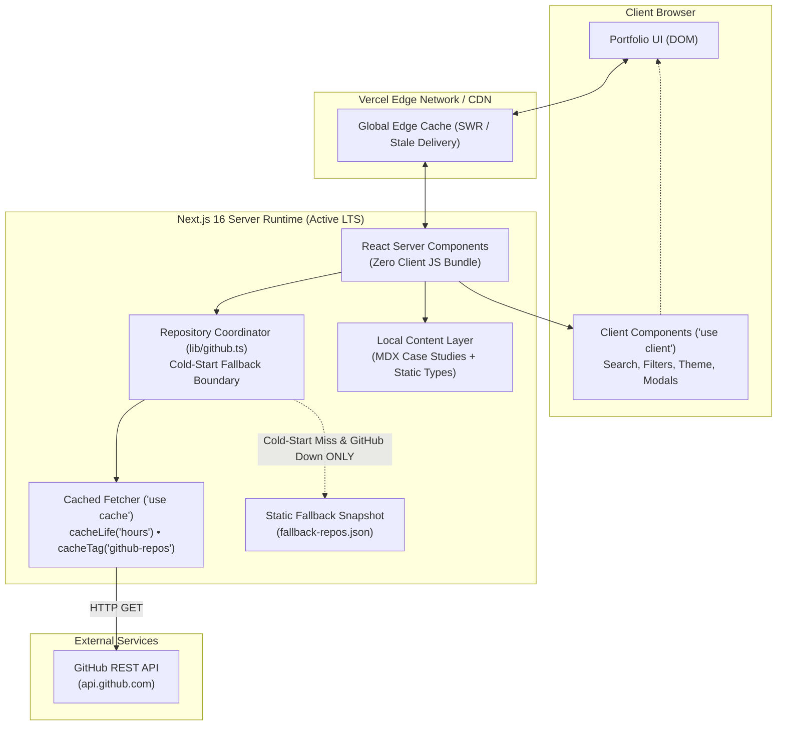
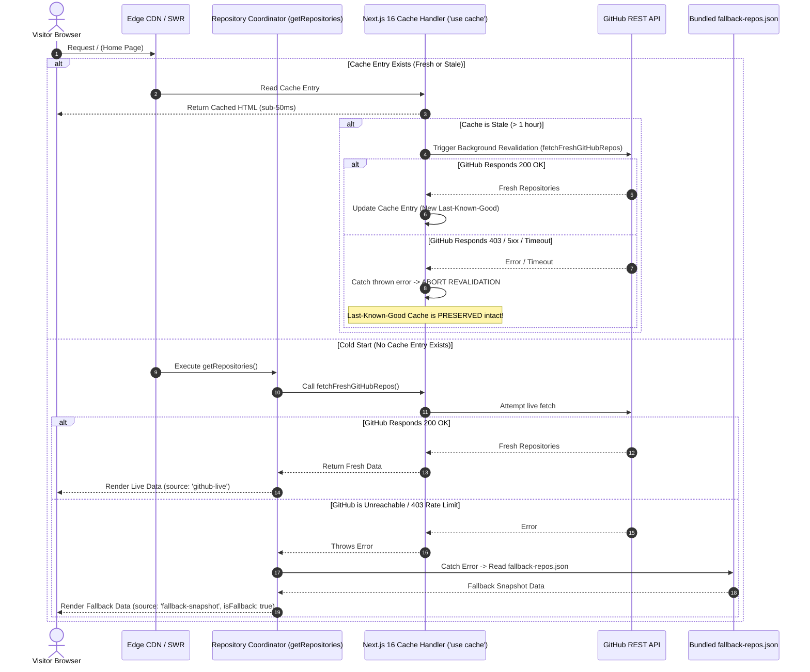

# System Architecture Specification

**Document Identifier:** `ARCH-PORTFOLIO-2026-PHASE1C`  
**Revision:** 3.0 (Remediated for Next.js 16 Active LTS & Cache Components)  
**Status:** PROPOSED (Awaiting User Phase 1 Approval Gate)  
**Author:** Principal Software Architect, Senior Next.js Engineer & Security Engineer  
**Target Platform:** Next.js 16 (Active LTS), React 19, TypeScript, Tailwind CSS, Vercel  
**Standards Alignment:** ISO/IEC 25010:2023, ISO/IEC 27001:2022 (Principles), Vercel React Best Practices

---

## 1. Architectural Philosophy & Core Decisions

The architecture of this portfolio is guided by five foundational tenets:

1. **Zero-Database, Zero-CMS Overhead:**  
   Unlike traditional full-stack CMS architectures (such as the previous `portfolio-cms` with Express, Prisma, and PostgreSQL), this application eliminates database connection pools, cold starts, credential management, migration scripts, and hosting costs. Presentation content resides in typed local Markdown/MDX files version-controlled directly in Git.
2. **Next.js 16 Cache Components (`use cache` & `cacheLife`):**  
   The application adopts Next.js 16 Active LTS and standardizes on **Cache Components** as its single, unified caching architecture. Revalidation timing is declared at the function level using `cacheLife('hours')` (revalidate: 1 hour, stale: 5 minutes, expire: 1 day), replacing legacy per-fetch option flags.
3. **Strict Server Component Primacy:**  
   React Server Components (RSC) serve as the default execution model. Client Components (`"use client"`) are strictly quarantined to the interactive leaves of the component tree (e.g., search bars, filter buttons, modals, and animation wrappers).
4. **Three-Tier Non-Destructive Data Resilience:**  
   The architecture strictly distinguishes:
   - *Tier 1: Freshly Fetched GitHub Data* (retrieved upon successful 200 OK from GitHub API).
   - *Tier 2: Last-Known-Good Cached Data* (persisted in Next.js Cache Handler and served during upstream downtime).
   - *Tier 3: Bundled Fallback Snapshot* (`lib/fallback-repos.json`, used solely on initial cold starts if no cache exists and GitHub is unreachable).  
   **Architectural Invariant:** A failed background revalidation must never overwrite valid last-known-good cached data with an older build-time fallback snapshot.
5. **No Speculative Abstractions:**  
   Avoid introducing unnecessary state managers (Redux, MobX), heavy 3D rendering engines unless strictly necessary, or multi-package monorepos for a single portfolio application.

---

## 2. Technology Stack Selection & Framework Decision

| Layer | Chosen Technology | Evaluated Alternatives | Rationale & Architectural Evaluation |
| :--- | :--- | :--- | :--- |
| **Framework** | **Next.js 16.x (Active LTS)** | Next.js 15 (Maintenance LTS), Vite + React SPA, Astro | • **Next.js 16 Active LTS:** Official Next.js support policy designates Next.js 16 as Active LTS and Next.js 15 as Maintenance LTS. Next.js 16 provides long-term security patching, React 19 stability, and native Cache Components.<br>• **Unified Caching Model:** Next.js 16 standardizes Cache Components (`use cache`, `cacheLife`, `cacheTag`), completely replacing legacy `next: { revalidate }` fetch options and `unstable_cache`. This provides declarative, function-level caching without experimental flags. |
| **Language** | **TypeScript 5.x** | Pure JavaScript | Strict type safety across GitHub API responses, MDX frontmatter, and component contracts with zero runtime overhead. |
| **Styling** | **Tailwind CSS v4** | CSS Modules, Styled Components, Vanilla CSS | High-performance, zero-runtime CSS bundle extraction using modern CSS variables and OKLCH color spaces. |
| **Data Layer** | **GitHub REST API + Local MDX** | Supabase, Headless CMS (Sanity/Strapi), PostgreSQL + Prisma | Eliminates database maintenance, monthly server costs, and security surfaces. Code and content are co-located in Git. |
| **Icons** | **Lucide React** | React Icons, FontAwesome | Tree-shakeable, clean SVG iconography matching modern developer tools. |
| **Animation Primitive** | **Motion (formerly Framer Motion)** | GSAP, Vanilla CSS keyframes | Declarative spring physics, exit animations, and strict `prefers-reduced-motion` compliance. Client-only wrapper components ensure zero SSR hydration mismatch. |

---

## 3. High-Level System Architecture Diagram



---

## 4. Directory & Module Structure

Adhering strictly to `vercel-react-best-practices` (avoiding barrel files, maintaining clear domain boundaries, and isolating server/client boundaries):

```text
new-portfolio/
├── .agents/                      # Agent skills and lockfiles (read-only verification)
│   ├── skills/
│   │   ├── vercel-react-best-practices/
│   │   └── web-design-guidelines/
│   └── skills-lock.json
├── docs/                         # Architecture, PRD, and integration plans
│   ├── GITHUB_INTEGRATION_PLAN.md
│   ├── PHASE_1_REPORT.md
│   ├── PROJECT_REQUIREMENTS.md
│   ├── QUALITY_STANDARDS.md
│   └── SYSTEM_ARCHITECTURE.md
├── content/                      # Curated project content & case studies
│   ├── case-studies/             # MDX deep-dive case studies
│   │   ├── sentinel-organizer.mdx
│   │   ├── meeting-mode.mdx
│   │   ├── sia-meal-snap.mdx
│   │   ├── quickaid-geomapping.mdx
│   │   └── valence-capital.mdx
│   └── curated-projects.ts       # Curated project highlights, metadata overrides & badges
├── public/                       # Static public assets, favicons, project screenshots
│   ├── images/
│   └── fonts/
├── src/                          # Application source code
│   ├── app/                      # Next.js 16 App Router
│   │   ├── (site)/               # Root marketing site route group
│   │   │   ├── layout.tsx        # Global shell layout with metadata & navigation
│   │   │   ├── page.tsx          # Home page (Hero, Featured, Skills, Experience, Contact)
│   │   │   ├── archive/
│   │   │   │   └── page.tsx      # Projects Archive & Repository Explorer
│   │   │   └── projects/[slug]/
│   │   │       └── page.tsx      # Deep-dive Project Case Study
│   │   ├── api/
│   │   │   └── revalidate/       # Optional on-demand webhook revalidation endpoint
│   │   │       └── route.ts
│   │   ├── error.tsx             # Root error boundary
│   │   ├── not-found.tsx         # Custom 404 page
│   │   ├── loading.tsx           # Instant Suspense fallback skeleton
│   │   ├── global.css            # Tailwind CSS directives & custom design tokens
│   │   └── sitemap.ts            # Dynamic XML sitemap generator
│   ├── components/
│   │   ├── ui/                   # Reusable atomic design tokens & primitives
│   │   │   ├── button.tsx
│   │   │   ├── badge.tsx
│   │   │   ├── card.tsx
│   │   │   ├── dialog.tsx
│   │   │   └── skeleton.tsx
│   │   ├── layout/               # Global shell components
│   │   │   ├── header.tsx        # Sticky header with active scroll spy
│   │   │   ├── footer.tsx        # Footer with status pill & social links
│   │   │   └── mobile-nav.tsx    # Ergonomic mobile slide drawer
│   │   └── features/             # Domain-specific functional sections
│   │       ├── hero/
│   │       ├── featured-projects/
│   │       ├── archive-explorer/ # Interactive client search & filter grid
│   │       ├── case-study/       # Case study layout & markdown rendering
│   │       ├── skills-matrix/
│   │       ├── experience/
│   │       └── contact/
│   ├── lib/                      # Core utilities & service clients
│   │   ├── github.ts             # GitHub API client with rate-limit & error protection
│   │   ├── fallback-repos.json   # Build-time snapshot of repository metadata
│   │   ├── mdx.ts                # MDX loader, frontmatter parser & schema validator
│   │   └── utils.ts              # ClassName merging (`clsx` + `tailwind-merge`)
│   └── types/                    # Shared TypeScript interfaces & Zod schemas
│       ├── github.ts             # GitHub API response types & Zod schemas
│       ├── project.ts            # Merged project model (Curated + GitHub Telemetry)
│       └── content.ts            # Case study frontmatter interface
├── next.config.ts                # Next.js 16 configuration (security headers, image remotePatterns)
├── tailwind.config.ts            # Design system tokens, typography & animations
├── tsconfig.json                 # TypeScript strict configuration
└── package.json
```

---

## 5. Next.js 16 Caching Architecture: Cache Components

Next.js 16 replaces the legacy `next: { revalidate }` fetch option with declarative **Cache Components**:

### Declarative Function-Level Caching (`use cache`)
```typescript
import { cacheLife, cacheTag } from 'next/cache';
import { GitHubReposArraySchema, type GitHubRepo } from '@/types/github';

// Isolated Cached Fetcher: Annotated with 'use cache'
async function fetchFreshGitHubRepos(): Promise<GitHubRepo[]> {
  'use cache';
  cacheLife('hours'); // Pre-configured profile: stale: 5m, revalidate: 1h, expire: 1d
  cacheTag('github-repos');

  const res = await fetch('https://api.github.com/users/SaucesCode/repos?type=owner&sort=pushed&direction=desc&per_page=100', {
    headers: {
      Accept: 'application/vnd.github+json',
      'X-GitHub-Api-Version': '2022-11-28',
      'User-Agent': 'SaucesCode-Portfolio-App',
      ...(process.env.GITHUB_TOKEN && {
        Authorization: `Bearer ${process.env.GITHUB_TOKEN}`,
      }),
    },
    signal: AbortSignal.timeout(6000),
  });

  if (!res.ok) {
    // CRITICAL: Throwing an error inside 'use cache' instructs Next.js to
    // abort revalidation and PRESERVE the existing Last-Known-Good cache!
    throw new Error(`[GitHub API] Upstream error: ${res.status}`);
  }

  const raw = await res.json();
  const parsed = GitHubReposArraySchema.safeParse(raw);

  if (!parsed.success) {
    throw new Error(`[GitHub API] Schema validation error: ${parsed.error.message}`);
  }

  return parsed.data;
}
```

### Architectural Advantages:
1. **Separation of Caching from Transport:** Caching is declared on the function, not tied to `fetch()` options.
2. **Explicit Lifecycles:** `cacheLife('hours')` defines clear `stale` (5 min), `revalidate` (1 hour), and `expire` (1 day) semantics.
3. **No Incompatible API Mixing:** Zero usage of legacy `fetch` `next.revalidate` or `unstable_cache`.

---

## 6. Non-Destructive Error Handling & Fallback Boundary

To resolve the contradiction where a failed revalidation could overwrite fresh cache with fallback data, the architecture separates the **Cached Fetcher** from the **Repository Coordinator**:



---

## 7. Production Content Security Policy (CSP) Design & Evaluation

### Technical Analysis of Next.js App Router Script Execution
Next.js App Router relies on inline scripts for:
1. **Flight Data Streaming:** React Server Component payloads streamed into the document.
2. **Bootstrap & Chunk Loading:** Dynamic chunk loading runtime.
3. **Hydration State:** Component state reconciliation during client hydration.

A rigid policy of `script-src 'self'` without inline allowances **blocks framework-generated bootstrap scripts and completely breaks React hydration**, resulting in a non-interactive, broken page.

### Architectural Evaluation of CSP Approaches:

| Approach | Mechanics | Security Posture | Performance & Hydration Impact | Recommendation |
| :--- | :--- | :--- | :--- | :--- |
| **Option A: Nonce-Based Middleware CSP** | Generates a cryptographic nonce per request (`crypto.randomUUID()`) via `middleware.ts`. Injects nonce into headers and Next.js script tags. | **Maximum.** Blocks all inline scripts lacking the request nonce. | **High Performance Penalty.** As documented by Next.js, nonces require **dynamic server rendering on every request**, completely eliminating static HTML edge CDN caching and ISR. | Not recommended for high-performance static portfolio. |
| **Option B: Strict Origin CSP with Hash-Based Scripts** | Hashes inline bootstrap scripts (`sha256-...`) in static headers. | **High.** Strictly allows only pre-approved inline script hashes. | **Fragile.** Script hashes change on every Next.js compilation/build, requiring custom post-build hash extraction tooling. | Viable optimization target for Phase 3/4. |
| **Option C: Pragmatic Origin & Inline-Hydration CSP (Recommended for Phase 1 Plan)** | Origin-locked policy via `next.config.ts` allowing `'self'` and `'unsafe-inline'` for hydration scripts and CSS extraction. **Zero `unsafe-eval` in production.** | **Strong & Realistic.** Eliminates `unsafe-eval` and foreign script origins. | **Optimal.** 100% compatible with static edge CDN caching, ISR, and seamless client hydration. | **Recommended Baseline.** |

### Recommended Production CSP Configuration (`next.config.ts`)
```typescript
const isDev = process.env.NODE_ENV === 'development';

const cspHeader = `
  default-src 'self';
  script-src 'self' 'unsafe-inline' ${isDev ? "'unsafe-eval'" : ''};
  style-src 'self' 'unsafe-inline';
  img-src 'self' blob: data: https://avatars.githubusercontent.com https://raw.githubusercontent.com;
  font-src 'self';
  object-src 'none';
  base-uri 'self';
  form-action 'self';
  frame-ancestors 'none';
  upgrade-insecure-requests;
`.replace(/\s{2,}/g, ' ').trim();
```

### Security/Performance Trade-Off Disclosure:
- **Trade-off:** Allowing `'unsafe-inline'` on `script-src` avoids forcing dynamic SSR on every request, preserving sub-50ms edge CDN delivery. The associated XSS risk is mitigated because the application has zero user-generated content, zero database injection vectors, and strictly uses React's automatic JSX escaping.
- **Verification Plan:** This CSP configuration is an **architectural proposal**. It will be formally verified against a production build (`next build && next start`) in a later implementation phase using Chrome DevTools MCP to assert zero console CSP violations and zero hydration errors.

---

## 8. GitHub Authentication & Token Scoping

- **Baseline Architecture:** **Unauthenticated public-data access is preferred initially.** With Next.js 16 Cache Components caching data for 1 hour (`cacheLife('hours')`), the total API consumption is well within the 60 requests/hour unauthenticated rate limit.
- **If Authentication Becomes Necessary:**
  - Classic `public_repo` scope is **strictly rejected** because it grants read AND write permissions to all public repositories.
  - The integration must use a **GitHub Fine-Grained Personal Access Token** scoped strictly to:
    - Target: "Public repositories (read-only)"
    - Repository Permissions: `Metadata: Read-only` (and `Contents: Read-only` only if reading file trees).
    - Storage: Server-only environment variable `GITHUB_TOKEN` in `.env.local` / Vercel Environment Variables. Strictly forbidden: `NEXT_PUBLIC_GITHUB_TOKEN`.

---

## 9. ISO/IEC 25010:2023 Quality Mapping

The architecture addresses the official nine characteristics of ISO/IEC 25010:2023:
1. **Functional Suitability:** Modularity and pure service layers guarantee functional completeness.
2. **Performance Efficiency:** Server Components minimize client bundles; Cache Components guarantee instant CDN delivery.
3. **Compatibility:** Standard semantic HTML and clean JSON-LD metadata ensure cross-browser co-existence.
4. **Interaction Capability:** Full WCAG 2.2 AA accessibility, visible focus states, and responsive navigation.
5. **Reliability:** Three-tier data model with non-destructive revalidation prevents UI crashes.
6. **Security:** Server-only secrets, least-privilege token access, and strict CSP headers.
7. **Maintainability:** Modular component tree, 100% TypeScript type safety, and clean file organization.
8. **Flexibility:** Fluid responsive layouts adapt from 320px mobile displays to 4K desktop screens.
9. **Safety:** Evaluated as Non-Applicable (N/A) with documented scope justification (static informational portfolio).

---

## 10. Summary of Architectural Decisions Awaiting Approval

- [x] **Framework:** Next.js 16.x Active LTS on React 19 and Node.js 20+ (Node v24 verified).
- [x] **Caching Model:** Next.js 16 Cache Components (`use cache`, `cacheLife('hours')`, `cacheTag`).
- [x] **Data Resilience:** Three-tier model ensuring failed revalidation preserves last-known-good cache.
- [x] **Authentication:** Unauthenticated public-data access preferred; fine-grained read-only tokens if needed.
- [x] **Production CSP:** Pragmatic static-compatible CSP without production `unsafe-eval`; testing plan defined.
